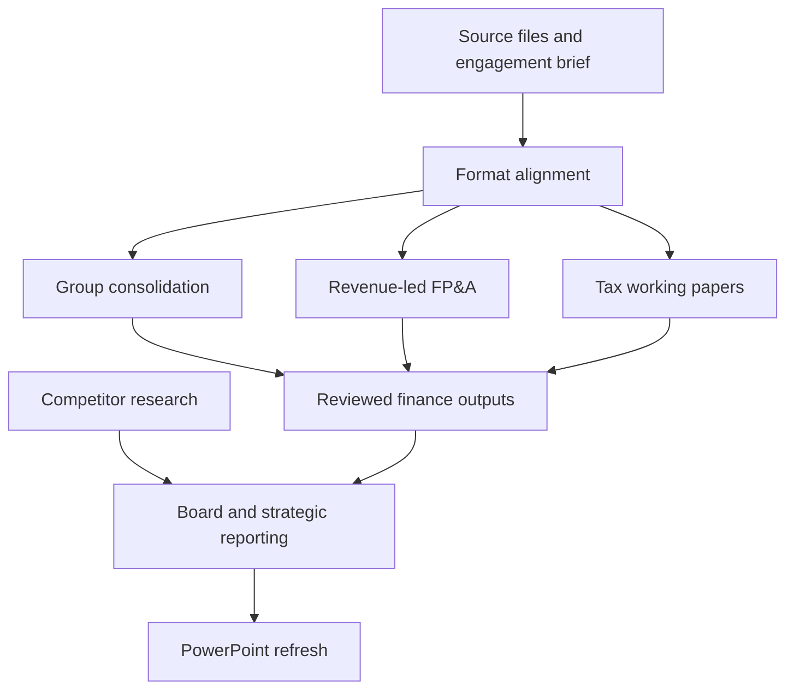

# AI for Finance Department

**Practical AI workflows for finance operations, planning, and management reporting.**

Turn fragmented finance data into structured, traceable work products: import files, tax working papers, forecasts, consolidation schedules, and decision-focused reports.

This repository contains reusable Markdown workflow specifications for finance teams and implementation projects. Each playbook defines the inputs, steps, expected deliverables, and review controls for a specific task. Execution depends on an AI assistant and suitable file, calculation, or research tools.

**Project stage:** workflow MVP · **Start here:** Version 2 · **Validation:** individual workflow checks vary; integrated client acceptance remains pending.

[Quick start](docs/QUICK_START.md) · [Workflow catalog](Version_2/README.md) · [Worked example](examples/revenue-led-planning/README.md) · [Roadmap](docs/ROADMAP.md)

## Why this project

Finance teams spend significant effort moving between spreadsheets, accounting systems, departmental submissions, and reporting templates. This project makes those handoffs explicit so that AI-assisted work can be repeated, checked, and adapted to a client's processes.

The approach is built around three outcomes:

- **Consistent preparation:** turn a broad request into a defined input, process, and output.
- **Traceable analysis:** connect figures and conclusions to source data, assumptions, and transformations.
- **Useful decisions:** explain performance, scenarios, exceptions, and the actions management needs to consider.

## Workflow catalog

| Workflow | Business purpose | Expected deliverables when executed |
| --- | --- | --- |
| [Accounting import alignment](Version_2/Accounting_Import_Format_Alignment_Skill.md) | Convert existing accounting exports to a specified system import format | Import candidate, field mapping, reconciliation, exception log |
| [U.S. GAAP and U.S. corporate tax](Version_2/US_GAAP_tax_Skill.md) | Prepare income-tax reporting and corporate tax working papers | Current/deferred tax schedules, proposed entries, return mapping, reviewer questions |
| [IFRS and Hong Kong profits tax](Version_2/HK_IFRS_tax_Skill.md) | Connect income-tax reporting with Hong Kong tax preparation | Book-to-tax reconciliation, tax schedules, proposed entries, BIR51 mapping |
| [Revenue-led FP&A](Version_2/FPandA_Skills.md) | Translate Sales estimates into departmental resources, costs, and profitability | Base, optimistic, and conservative cases; financial schedules; variance and decision analysis |
| [Format alignment](Version_2/Format_alignment_Skill.md) | Standardize finance data for ERP, reporting, or presentation targets | Target-format data, transformation rules, rejected records, validation report |
| [PowerPoint data refresh](Version_2/PowerPoint_Template_Data_Update_SKILL.md) | Update an existing deck with verified data while preserving its design | Updated editable deck, source-to-slide mapping, change log |
| [Board and strategic reporting](Version_2/Strategic_reporting_board_Skill.md) | Connect financial performance and strategic priorities to board decisions | Finance report, KPI scorecard, risk and decision registers, review handoff |
| [Group finance consolidation](Version_2/Consolidation_group_finance_Skill.md) | Combine entity submissions into a consistent group view | Combined dataset, mapping and reconciliation schedules, applicable consolidation adjustments |
| [Industry and competitor analysis](Version_2/Competitor-analysis-SKILL.md) | Assess competitive positioning and financial performance | Peer benchmarks, evidence-based comparisons, risks, scenarios, source register |

**Scope note:** accounting import alignment works with existing accounting records. A standalone workflow for general journal-entry preparation and accounting-treatment decisions is still planned. The [catalog](Version_2/README.md) explains overlapping workflows and older module references.

## Start with one task

1. **Choose a workflow** from the catalog and read its input requirements.
2. **Prepare the context:** entity, reporting period, currency, purpose, source files, and target template. Use the [engagement brief](templates/ENGAGEMENT_BRIEF.md).
3. **Give the workflow and inputs to your AI assistant.** Confirm that it can read the required files and create the requested outputs.
4. **Review the results:** reconcile totals, inspect exceptions, and record the responsible reviewer's decision before operational use.

For a small introduction, use the [synthetic revenue-led planning example](examples/revenue-led-planning/README.md). It includes Sales inputs, departmental costs, scenario assumptions, and expected results.

## How the workflows connect

These are possible handoffs, not automatic integrations. Run only the modules a task needs; carry the same period, entity scope, currency, scenario, and source version across each handoff. Accounting import alignment is the specialized path when the target is an accounting-system import.

## Revenue-led planning philosophy

Begin with the Sales department's revenue estimate by **client × segment × service type × region**. Translate that demand into departmental workload, resources, and detailed costs. Compare the resulting profitability with management's target, establish the base case, then change explicit assumptions to build optimistic and conservative cases.

Keep a management target separate from an evidence-supported forecast. A profitability shortfall should lead to a visible decision or action plan, rather than an unexplained adjustment to the numbers.

## Repository guide

| Location | Contents |
| --- | --- |
| [Version_2/](Version_2/README.md) | Starting point for the current collection of nine workflow specifications |
| [Version_1/](Version_1/README.md) | Earlier workflow versions retained for reference |
| [docs/QUICK_START.md](docs/QUICK_START.md) | Practical instructions for running and reviewing a workflow |
| [docs/ROADMAP.md](docs/ROADMAP.md) | Current capabilities, remaining gaps, and pilot milestones |
| [templates/](templates/ENGAGEMENT_BRIEF.md) | Reusable engagement brief and review record |
| [examples/](examples/revenue-led-planning/README.md) | Synthetic planning walkthrough with expected results |
| [CONTRIBUTING.md](CONTRIBUTING.md) | How to propose and document improvements |

## Review and readiness

The repository currently provides instructions and examples, rather than an installed application or live ERP integration. Workflow files contain their own version labels and validation notes; the folder name is not a software release number.

For each engagement, preserve source evidence, distinguish missing values from zero, record unresolved exceptions, and identify the review owner. Accounting and tax outputs remain draft working papers until the appropriate professional reviews them. Posting, filing, payments, and external distribution require a separately authorized operational process.

Client-specific data belongs in an approved private workspace. Public examples in this repository use fictional data. See the [review record](templates/REVIEW_RECORD.md) for a compact handoff format.

## Project author

Developed by [Xiaowen (Xavier) Chen](https://github.com/Xiaowen-CHEN-Learner) as part of **AI for Finance Department**, a project exploring practical AI implementation across the finance function.

Suggestions and reproducible workflow feedback are welcome through [GitHub Issues](https://github.com/Xiaowen-CHEN-Learner/AI-for-Finance-Department/issues) and pull requests. See [contribution guidance](CONTRIBUTING.md).

